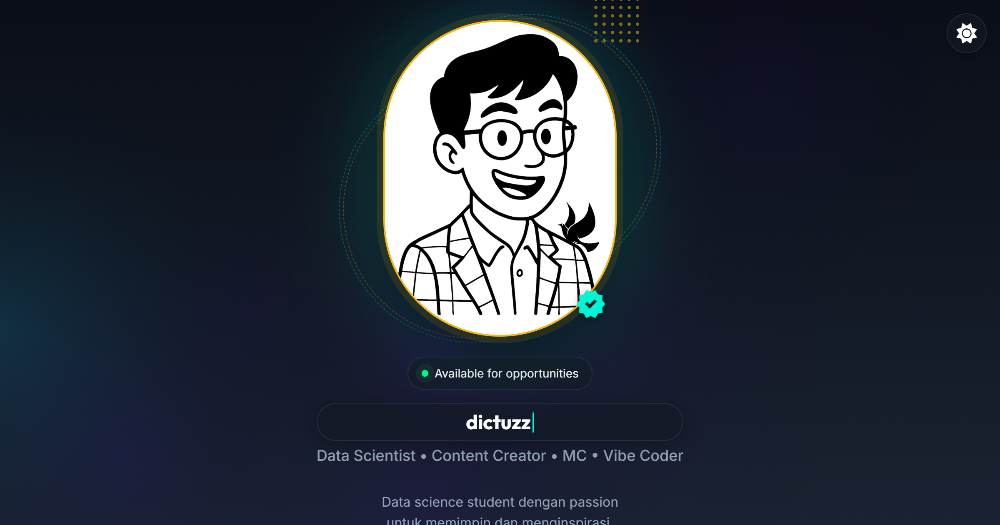

# Benedictus Richard Ricardo - Deep Space Portfolio

A modern, high-performance personal portfolio website featuring the premium **"Deep Space Luxury"** design system. Built to showcase data science expertise, leadership experience, and professional skills.

> Part of the [dictuzz.github.io](https://dictuzz.github.io) ecosystem



---

## 📂 Portfolio Structure

The live portfolio is served from the **`/portfolio/`** directory and is accessible at **https://dictuzz.me/portfolio/**.

> **Note:** Legacy/duplicate portfolio directories (`portofolio/` and `portfolio-app/`) have been removed. `portfolio/` is the sole deployed portfolio — do not delete it.

---

## 🌌 Design System

The portfolio implements the "Deep Space Luxury" visual language with these core elements:

### Color Palette

| Token | Name | Value | Usage |
|-------|------|-------|-------|
| `--bg-deep` | **Deep Space** | `#0A0E17` | Background (dark) |
| `--bg-surface` | **Surface** | `#121824` | Cards, nav |
| `--accent-cyan` | **Cyber Cyan** | `#00F5D4` | Primary accent |
| `--accent-purple` | **Electric Purple** | `#7B61FF` | Secondary accent |
| `--accent-gold` | **Luxury Gold** | `#FFB800` | Highlights |

### Light Mode

| Token | Value | Usage |
|-------|-------|-------|
| `--bg-deep` | `#E2E8F0` | Slate background |
| `--text-primary` | `#0F172A` | Dark text |

### Typography

| Role | Font |
|------|------|
| **Headings** | Outfit, Space Grotesk |
| **Body** | Inter |

### Theme Synchronization

The resume inherits the unified theme key `dictuzz-theme` and `config.js` settings:

```javascript
// Inherited from root config.js
const storageKey = CONFIG_DATA.theme.storageKey || 'dictuzz-theme';
```

This ensures theme consistency across the entire ecosystem.

---

## ⚡ Key Features

### Dynamic Content
### Dynamic Content
- **Content Source**: All text is driven by `locales/*.json` (En/Id/De).
- **System Config**: Global settings (Theme, Analytics, Feature Flags) are inherited from the root `config.js`.
- **i18n Support**: Auto-detects browser language or uses `?lang=id`.

### Performance
- **Zero Frameworks**: Vanilla JS/CSS
- **Lighthouse 100**: Optimized for speed
- **Critical CSS**: Inlined for instant rendering

### Interactive
- **Typing Animation**: Rotating tagline effect
- **Theme Toggle**: Dark/light with persistence
- **Smooth Scroll**: Anchor navigation
- **GA4 Analytics**: Track interactions

---

## 🛠️ Tech Stack

| Category | Technology |
|----------|------------|
| **Core** | HTML5, CSS3, JavaScript (ES6+) |
| **Styling** | CSS Custom Properties, Glassmorphism |
| **Fonts** | Google Fonts (Outfit, Space Grotesk, Inter) |
| **Icons** | FontAwesome 6 |

---

## 🚀 Getting Started

### Local Development

```bash
# From project root
npx -y serve -l 8000

# Open
http://localhost:8000/
```

### Language Selection

Use URL parameter or button:
- `?lang=en` - English
- `?lang=id` - Indonesian
- `?lang=de` - German

---

## 📁 Project Structure

```text
.
├── index.html              # Main HTML structure
├── script.js               # i18n, animations, theme
├── style.css               # Component styles
├── css/
│   └── tokens.css          # ⭐ Design tokens (colors, spacing)
├── locales/                # ⭐ Content data
│   ├── en.json             # English
│   ├── id.json             # Indonesian
│   └── de.json             # German
├── BRAND_GUIDELINE.md      # Detailed design documentation
└── README.md               # This file
```

---

## 📝 Content Management

### Editing Content

All content is in `locales/*.json`. Edit the appropriate language file:

```json
{
  "hero": {
    "greeting": "Hello, I'm",
    "name": "Benedictus Richard Ricardo",
    "typing": ["Data Science Student", "Automation Specialist", "Process Builder"]
  },
  "experience": [
    {
      "title": "Data Scientist",
      "company": "Company Name",
      "date": "2024 - Present",
      "bullets": ["Achievement 1", "Achievement 2"]
    }
  ]
}
```

### Adding a Language

1. Create `locales/xx.json` (copy from `en.json`)
2. Add to `SUPPORTED_LANGS` in `script.js`:
   ```javascript
   const SUPPORTED_LANGS = ['en', 'id', 'de', 'xx'];
   ```
3. Add language button in `index.html`

---

## JavaScript Modules

The `script.js` contains these features:

| Feature | Function |
|---------|----------|
| Theme Toggle | `initTheme()`, `toggleTheme()` |
| i18n System | `loadLanguage(lang)`, `applyTranslations()` |
| Typing Effect | `Typer` class |
| Rendering | `renderExperience()`, `renderProjects()`, `renderSkills()` |
| Analytics | `trackEvent()` integration with GA4 |

---

## Design Tokens

Edit `css/tokens.css` to customize the design:

```css
:root {
  /* Colors */
  --bg-deep: #0A0E17;
  --accent-cyan: #00F5D4;
  
  /* Typography */
  --font-display: 'Outfit', sans-serif;
  --font-body: 'Inter', sans-serif;
  
  /* Spacing (8px grid) */
  --space-4: 1rem;
  --space-8: 2rem;
  
  /* Transitions */
  --ease-out: cubic-bezier(0.16, 1, 0.3, 1);
}
```

---

## License

© 2026 Benedictus Richard Ricardo. All Rights Reserved.

*Last updated: February 2026*
