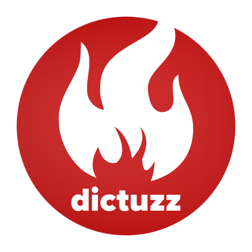

# Benedictus Richard Ricardo - Personal Portfolio

A modern, high-performance personal portfolio website designed with a premium **Glassmorphism** aesthetic. Built to showcase data science projects, leadership experience, and professional skills with a focus on speed, accessibility, and analytics.



---

## 🌟 Key Features

### 1. Dynamic Core
*   **JSON-Driven Content**: All text (Experience, Projects, Bio) is separated from code in `locales/en.json` (and `id`, `de`).
*   **Auto-Rendering**: Adding a new project or job experience involves editing a single JSON file; the DOM updates automatically.
*   **Internationalization (i18n)**: Seamlessly supports English, Indonesian, and German with auto-detection of browser language.
*   **Typing Animation**: Dynamic hero section with animated typing effect cycling through multiple roles.

### 2. High Performance
*   **Skeleton UI**: "Shimmer" loading states prevent blank screens while content fetches.
*   **Lazy Loading**: Google Fonts load asynchronously, images use `loading="lazy"`, and GA4 loads on user interaction.
*   **Lightweight**: Zero external heavy frameworks; pure Vanilla JS/CSS ensuring lightning-fast loads.
*   **Graceful Degradation**: Error handling with user-friendly retry mechanism for failed JSON loads.

### 3. Modern Design
*   **Glassmorphism**: Translucent cards with backdrop blur and dynamic mesh gradient background.
*   **CSS Architecture**: Powered by `:root` variables for instant one-line theming.
*   **Responsive**: "Bento Grid" layouts that adapt perfectly from mobile to desktop.
*   **Color Theme**: Rich Blue (`#102F42`), Ghost White (`#F0EFF4`), and Chinese Gold (`#CC9900`).

### 4. Smart Analytics & SEO
*   **Google Analytics 4**: Lazy-loaded tracking of CV Downloads, Language Switches, and Outbound Links.
*   **SEO Ready**: Open Graph tags for social sharing and JSON-LD `Person` Schema for Google rich results.

### 5. Accessibility (A11y)
*   **Semantic HTML**: Proper heading hierarchy and ARIA attributes.
*   **Focus States**: Clear visual focus indicators for all interactive elements.
*   **Screen Reader Support**: `aria-live` regions for dynamic content updates.

---

## 🛠️ Tech Stack

*   **Core**: HTML5, CSS3, Vanilla JavaScript (ES6+).
*   **Architecture**: Fetch API-based i18n, Component Rendering, Class-based Typing Animation.
*   **Styling**: Vanilla CSS3 (Flexbox/Grid, Custom Properties, Backdrop Filter, Animations).
*   **Analytics**: Google Analytics 4 (Lazy-loaded with Custom Events).
*   **Assets**: FontAwesome (Icons), Google Fonts (Inter/Plus Jakarta Sans).

---

## 🚀 Getting Started

### Prerequisites
You need a local development server because the `fetch()` API requires the `http://` or `https://` protocol.

### Installation

1.  **Clone the repository**:
    ```bash
    git clone https://github.com/dictuzz/dictuzz.github.io.git
    cd dictuzz.github.io
    ```

2.  **Run locally** (choose one):
    *   **Using Node.js (npx)**:
        ```bash
        npx -y serve -l 8000
        ```
    *   **Using Python**:
        ```bash
        python -m http.server 8000
        ```

3.  **Open in Browser**:
    Visit `http://localhost:8000`

---

## 📂 Project Structure

```
dictuzz.github.io/resume/
├── index.html          # Main HTML structure (GA4, SEO Meta, Skeleton UI, A11y)
├── style.css           # Global styles, Variables, Animations, Responsive Design
├── script.js           # Logic: i18n, Component Rendering, Typing Animation, Analytics
├── locales/            # Translation & Data Files
│   ├── en.json         # English Data
│   ├── id.json         # Indonesian Data
│   └── de.json         # German Data
├── Aku.webp            # Hero profile photo
├── api.webp            # About section photo
├── og-image.png        # Open Graph social preview image
└── README.md           # Documentation
```

---

## 🎨 Design System

### Color Palette
| Variable | Color | Usage |
|----------|-------|-------|
| `--bg-primary` | `#102F42` | Rich Blue background |
| `--text-primary` | `#F0EFF4` | Ghost White text |
| `--accent-gold` | `#CC9900` | Chinese Gold accents |

### Typography
*   **Headings**: Plus Jakarta Sans (800 weight)
*   **Body**: Inter (300-700 weights)

---

## ⚙️ How to Update Content

### 1. Adding a Job or Project
Open `locales/en.json` (and `id.json`/`de.json`) and add a new object to the array.

**Example (Experience):**
```json
"exp": [
    {
        "date": "Jan 2025 – Present",
        "role": "Your Role",
        "company": "Company Name",
        "details": ["Achievement 1", "Achievement 2"]
    }
]
```

### 2. Updating Typing Animation Words
Edit the `hero.typing.dynamicTexts` array in each locale file:
```json
"typing": {
    "staticText": "Aspiring Data Scientist & ",
    "dynamicTexts": ["Team Player", "Problem Solver", "Innovator"]
}
```

### 3. Changing the Theme
Open `style.css` and modify the `:root` variables at the top:
```css
:root {
    --bg-primary: #102F42;    /* Background color */
    --accent-gold: #CC9900;   /* Accent color */
}
```

---

## 🔮 Future Roadmap

- [ ] **Blog Integration**: Add a Markdown parser to render blog posts from a `posts/` folder.
- [ ] **Dark/Light Mode Toggle**: Leverage CSS variables for theme switching.
- [ ] **PWA Implementation**: Add `manifest.json` and Service Worker for installability.
- [ ] **Automated Testing**: Add Cypress/Playwright tests for JSON integrity.

---

## 📋 Version History

### v2.0 (December 2024)
*   Complete refactor with modular JSON-driven architecture
*   Added typing animation in hero section
*   Implemented skeleton loading states
*   Integrated lazy-loaded Google Analytics 4
*   Enhanced accessibility with ARIA attributes
*   Updated color theme to Rich Blue/Ghost White/Chinese Gold
*   Added smooth fade transitions for language changes

### v1.0 (2024)
*   Initial release with static content

---

## 📄 License
© 2025 Benedictus Richard Ricardo. All Rights Reserved.
